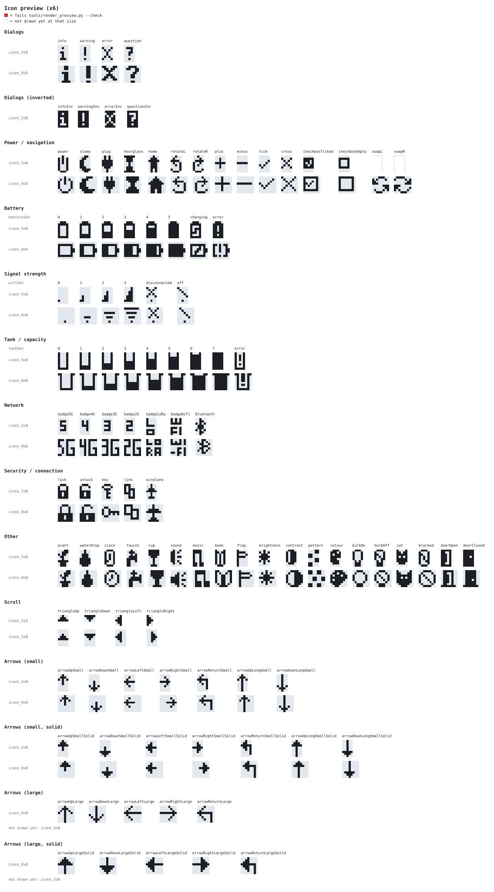

# icons

Pixel icons for small monochrome displays: SSD1306/SH1106 OLEDs and HD44780 character LCDs. Each size is drawn by hand rather than scaled from vector icons, so the icons stay crisp at a few pixels tall.

The library is header-only C++ for Arduino and PlatformIO. The same headers also work as an ESPHome external component.



## Sizes

| Namespace | Header | Size | Use |
|---|---|---|---|
| `oli::icons_5x8` | `icons_5x8.h` | 5x8 | HD44780 custom characters (LCD1602, LCD2004) | 
| `oli::icons_8x8` | `icons_8x8.h` | 8x8 | OLED status bars; Adafruit GFX size-1 text | 
| `oli::icons_5x3` | `icons_5x3.h` | 5x3 | Scrollbar and menu triangles on graphic displays | 

Every size uses the same icon names, so code picks the size in one place:

```cpp
namespace ic = oli::icons_8x8;
```

The bitmap sizes use row-major data, 1 bit per pixel, MSB = leftmost pixel, with each row padded to whole bytes. That's the format of `Adafruit_GFX::drawBitmap()` and of ESPHome's 1-bit images. The 5x8 glyphs use the HD44780 format: 8 rows, with the low 5 bits as pixels.

## Arduino / PlatformIO

Add the repo to `lib_deps` in `platformio.ini`, pinned to a tag:

```ini
lib_deps = https://github.com/simonmetcalfe/oled-lcd-icons.git#v0.1.0
```

While developing alongside a local checkout, use a symlink instead:

```ini
lib_deps = symlink://../oled-lcd-icons
```

Then:

```cpp
#include <oli_icons.h>

namespace ic = oli::icons_8x8;

display.drawBitmap(x, y, ic::wifi3, ic::W, ic::H, SSD1306_WHITE);

// A level from 0-100
const uint8_t* bmp = oli::frame(ic::batterySet, oli::levelIndex(percent, ic::batteryLevels));
display.drawBitmap(x, y, bmp, ic::W, ic::H, SSD1306_WHITE);

// HD44780: load a glyph into slot 0-7, then print it as "\x08"-"\x0F" (avoids a NUL in strings)
oli::loadChar(lcd, 0, oli::icons_5x8::plant);
```

To pick the size per PlatformIO environment, set `build_flags = -D OLI_ICONS=oli::icons_8x8` and write `namespace ic = OLI_ICONS;`.

Icons you don't use are dropped at build time. On AVR the data stays in flash (`PROGMEM`).

## ESPHome

```yaml
external_components:
  - source: github://simonmetcalfe/oled-lcd-icons@v0.1.0
    components: [oli_icons]

oli_icons:

display:
  - platform: ssd1306_i2c
    model: "SH1106 128x64"
    lambda: |-
      namespace ic = oli::icons_8x8;
      oli::draw(it, 0, 0, ic::wifi3, ic::W, ic::H);
      oli::draw(it, 12, 0, oli::frame(ic::batterySet, oli::levelIndex(id(battery_pct), ic::batteryLevels)), ic::W, ic::H);
```

`oli_icons:` loads the component, and ESPHome then makes its headers available in display lambdas. `oli::draw()` draws only the icon's "on" pixels; pass `COLOR_OFF` to draw a dark icon on a lit area.

For character LCDs, ESPHome defines custom glyphs in YAML (`user_characters:`), using the same 5-bit rows as `icons_5x8.h`.

`examples/esphome_test.yaml` compiles the component from this checkout (`esphome compile examples/esphome_test.yaml`). It hasn't been run yet.

## Editing icons

The headers are the source of truth. Each row's `0b…` digits are the pixels, and the comment after each row is the same row drawn with `X` and `.`. After editing, run:

```sh
python3 tools/render_preview.py --check
```

This redraws `docs/preview.svg`, which shows each icon with its sizes one under the other. It fails if:

- a row's comment doesn't match its bits;
- bits are set in a row's padding;
- two icons in a size are identical;
- a name is defined twice in a size;
- a set's level count differs between sizes.

It also lists, for each size, the icons not drawn yet.

To add a size, create `icons_<W>x<H>.h` with `namespace oli { namespace icons_<W>x<H> {`, using the same icon names and set level counts. Then add it to `oli_icons.h`.

## Credits and license

MIT, see `LICENSE`.

With thanks to [OLED-Icons-](https://github.com/MusicalCreeper01/OLED-Icons-) by Keith Mitchell: "Copyright (c) 2016 KeithM", and [OLED Display Studio](https://dtechniker.github.io/OLED-Display-Studio/) ([source](https://github.com/dtechniker/OLED-Display-Studio)) by DTech.
